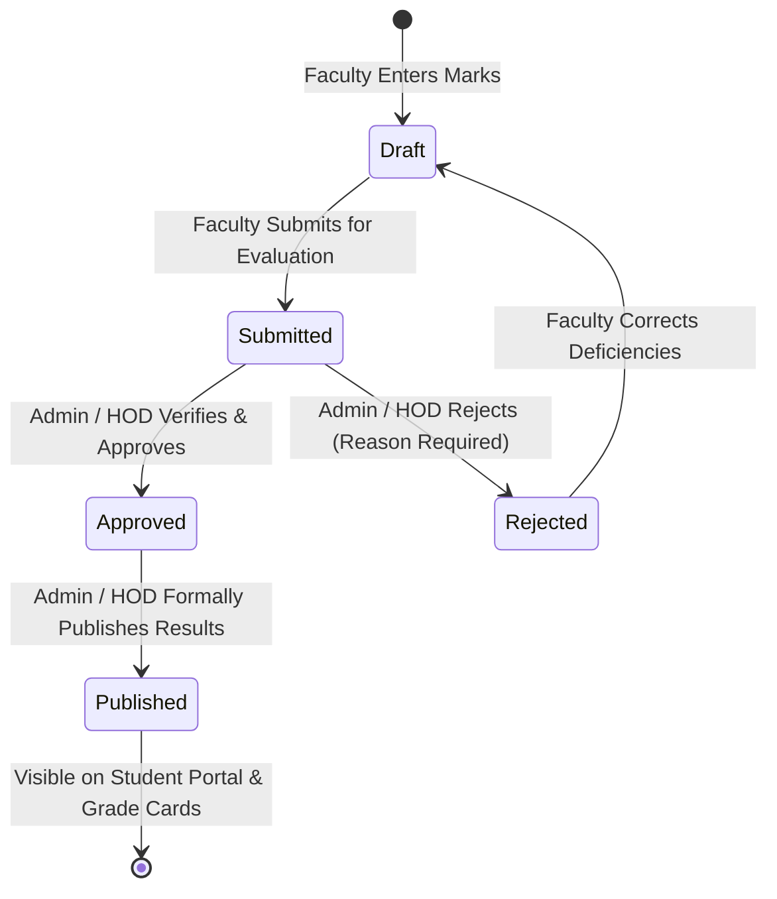
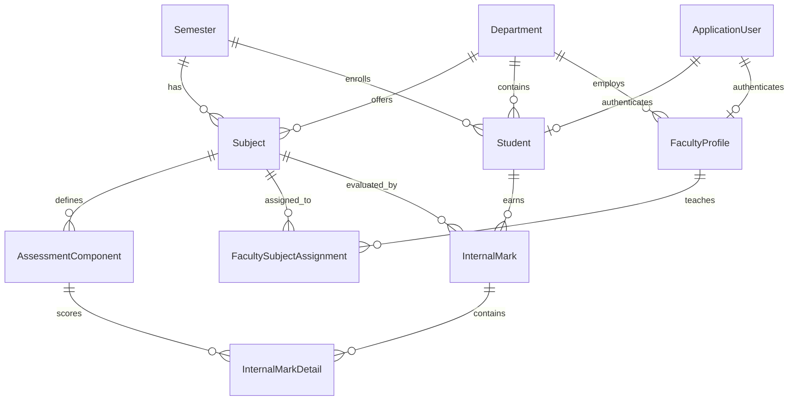

# Internal Marks Management System

A production-grade, full-stack **ASP.NET Core MVC** college web application designed to digitize internal examination marks, eliminate manual calculation errors, prevent duplicate academic records, configure weighted assessment components, manage approval workflows, and generate academic performance reports.

---

## 1. Project Information & Tech Stack

- **Framework:** ASP.NET Core MVC (.NET 8 / .NET 10 compatible)
- **Language:** C# 12 / 13
- **ORM:** Entity Framework Core Code-First with Migrations
- **Primary Database Provider:** MySQL via `Pomelo.EntityFrameworkCore.MySql`
- **Fallback / Local Provider:** SQLite (for instant zero-configuration development without external server dependencies)
- **Authentication & Authorization:** ASP.NET Core Identity with role-based access control (RBAC)
- **Frontend:** HTML5, CSS3, JavaScript, Bootstrap 5, Bootstrap Icons, Chart.js
- **Architecture:** Model-View-Controller (MVC) with clean Separation of Concerns (Services, ViewModels, Repository pattern via EF Core)

---

## 2. System Architecture & Workflow

### A. Approval & Publication Pipeline

The system enforces an immutable 4-stage governance pipeline:



### B. Entity-Relationship Model



---

## 3. Seeded Accounts & Default Credentials

The system automatically initializes and seeds default roles and demo accounts on first launch:

| Role | Name | Email / Username | Password | Access Privileges |
| :--- | :--- | :--- | :--- | :--- |
| **Admin / HOD** | Dr. A. K. Sharma | `admin@college.edu` | `Admin@123` | Full administrative control, student & subject CRUD, faculty assignment, marks review, rejection, approval & publishing, audit logs. |
| **Faculty** | Prof. Rajesh Sharma | `faculty.sharma@college.edu` | `Faculty@123` | Assigned to `CS501` & `CS502`. Enters & edits marks, saves drafts, submits to HOD, views subject analytics. |
| **Faculty** | Dr. Ananya Patel | `faculty.patel@college.edu` | `Faculty@123` | Assigned to `CS503` & `IT501`. Enters marks, manages drafts. |
| **Student** | Rahul Verma | `student.rahul@college.edu` | `Student@123` | Enrolled in Semester 5 (CSE). Views published marks, component scores, percentage, grades, and prints grade cards. |
| **Student** | Sneha Nair | `student.sneha@college.edu` | `Student@123` | Enrolled in Semester 5 (CSE). Views published marks. |
| **Student** | Vikram Singh | `student.vikram@college.edu` | `Student@123` | Enrolled in Semester 5 (CSE). Views published marks. |
| **Student** | Pooja Rao | `student.pooja@college.edu` | `Student@123` | Enrolled in Semester 5 (CSE). Views published marks. |

> **Tip:** The application header and login screen include **One-Click Demo Switcher** buttons to instantly jump between Admin, Faculty, and Student personas during testing and presentation.

---

## 4. Key Modules & Features

### 1. Modern Role-Based Dashboard
- **Admin/HOD View:** Metric cards for total students, subjects, faculty, records, pending reviews, and published results. Interactive Chart.js graphs displaying subject-wise class averages and pass/fail distributions. Recent audit activity stream.
- **Faculty View:** Assigned subjects, evaluation status summary, draft counter, quick action buttons for marks entry.
- **Student View:** Clean academic dossier, published semester results table, GPA/percentage summary, and 1-click printable grade card.

### 2. Student Management (CRUD)
- Full CRUD operations with server-side and client-side validation.
- Fields: Full Name, Enrollment Number (unique), Email (unique), Department, Semester, Enrollment Year.
- Real-time search by name, enrollment number, or email.
- Filtering by academic Department and Semester.
- Automatic creation and synchronization of ASP.NET Core Identity login credentials.

### 3. Subject & Assessment Scheme Configuration
- Subject metadata: Subject Code (unique), Subject Name, Department, Semester, Credits, Maximum Internal Marks (e.g. 50), Passing Marks (e.g. 20).
- Configurable **Assessment Components** per subject:
  - Internal Test 1
  - Internal Test 2
  - Assignments
  - Practical / Viva / Seminar
- Flexible Maximum Marks and Weight Percentages (validated to enforce $\sum \text{Weights} = 100\%$).

### 4. Mathematical Marks Calculation Engine
- Isolated, reusable service class (`IMarksCalculationEngine` / `MarksCalculationEngine`).
- **Normalized Weighted Formula:**
  $$\text{Contribution}_i = \left( \frac{\text{Marks Obtained}_i}{\text{Component Max}_i} \right) \times \left( \text{Subject Max} \times \frac{\text{Weight Percentage}_i}{100} \right)$$
  $$\text{Final Internal Score} = \min\left(\sum \text{Contribution}_i, \text{Subject Max}\right)$$
  $$\text{Percentage} = \left( \frac{\text{Final Internal Score}}{\text{Subject Max}} \right) \times 100\%$$
- **Configured Academic Grading Scale:**
  - $\ge 90\%$: **O** (Outstanding)
  - $\ge 80\%$: **A+** (Excellent)
  - $\ge 70\%$: **A** (Very Good)
  - $\ge 60\%$: **B+** (Good)
  - $\ge 50\%$: **B** (Above Average)
  - $\ge 40\%$: **C** (Pass)
  - $< 40\%$: **F** (Fail)
- **Pass / Fail Determination:** Evaluated against subject passing threshold (`PassingMarks`).

### 5. Responsive Marks Entry
- Dynamic client-side calculation updating weighted totals, percentages, and projected grades live as marks are entered.
- Strict boundary validation on client and server ($0 \le \text{marks} \le \text{Component Max}$).
- "Save as Draft" for saving in-progress grading.
- "Submit for HOD Approval" locks the records and forwards them for administrative verification.
- Rejection workflow: If HOD rejects, the required justification is displayed as an alert banner so faculty can revise and re-submit.

### 6. Reports & Export Capabilities
- **Student Grade Card / Marksheet:** Official college format with college header, student details, course breakdown, credits, aggregate score, percentage, result, grading key, and signature blocks. Includes clean `@media print` styling for 1-click **Save as PDF** or print.
- **Subject Analytics Report:** Class average, highest score, lowest score, pass percentage, pass/fail ratio, grade distribution bar chart, and ranked student score table.
- **Semester Report:** Consolidated semester overview with subject comparisons.
- **Excel Export:** Live CSV file generator formatted with UTF-8 BOM for Microsoft Excel.

### 7. Security, Validation & Audit Trail
- ASP.NET Core Identity authentication with cookie security (`HttpOnly`, `SlidingExpiration`).
- Anti-Forgery Token (`[ValidateAntiForgeryToken]`) protection on all mutating actions.
- Role-based authorization (`[Authorize(Roles = "...")]`) securing endpoints.
- Insecure Direct Object Reference (IDOR) prevention (students can only query their own records).
- Immutable `AuditLog` recording every login, creation, modification, submission, approval, and publication with user, timestamp (UTC), IP, and details.

---

## 5. Database Configuration & Setup

### Database Provider Modes (`appsettings.json`)
The application supports **Dual Database Providers**:

1. **MySQL via Pomelo (Default / Production Mode):**
   ```json
   "ConnectionStrings": {
     "DefaultConnection": "Server=localhost;Port=3306;Database=internal_marks_db;User=root;Password=your_password;CharSet=utf8mb4;",
     "SqliteConnection": "Data Source=internal_marks.db"
   },
   "DatabaseProvider": "Auto"
   ```
   - `"DatabaseProvider": "MySql"` &mdash; Connects directly to MySQL.
   - `"DatabaseProvider": "Auto"` &mdash; Probes port 3306. If MySQL is detected, uses Pomelo MySQL; if MySQL is not running, falls back gracefully to SQLite so the application starts immediately without setup hurdles.
   - `"DatabaseProvider": "Sqlite"` &mdash; Uses local SQLite file (`internal_marks.db`).

### Running EF Core Migrations for MySQL
To apply migrations or generate schema against MySQL:
```bash
# Update MySQL database
dotnet dotnet-ef database update

# Or generate raw SQL script for phpMyAdmin / MySQL Workbench
dotnet dotnet-ef migrations script -o Migrations/InitialCreate.sql
```

A complete SQL migration script is pre-generated at `Migrations/InitialCreate.sql`.

---

## 6. How to Run the Application

### Prerequisites
- .NET SDK (version 8.0, 9.0, or 10.0)
- Optional: MySQL Server 8.0 / MariaDB (e.g. XAMPP, WAMP, or standalone MySQL service)

### Step-by-Step Execution Commands

1. Open a terminal and navigate to the project directory:
   ```bash
   cd C:\Users\Pruthvi\.gemini\antigravity\scratch\InternalMarksSystem
   ```

2. Restore NuGet dependencies and build the application:
   ```bash
   dotnet restore
   dotnet build
   ```

3. Run the application:
   ```bash
   dotnet run
   ```

4. Open your web browser and navigate to:
   ```
   http://localhost:5000  (or https://localhost:5001)
   ```

5. Log in using any of the seeded credentials above, or use the **Quick Demo Login** buttons on the login page.
